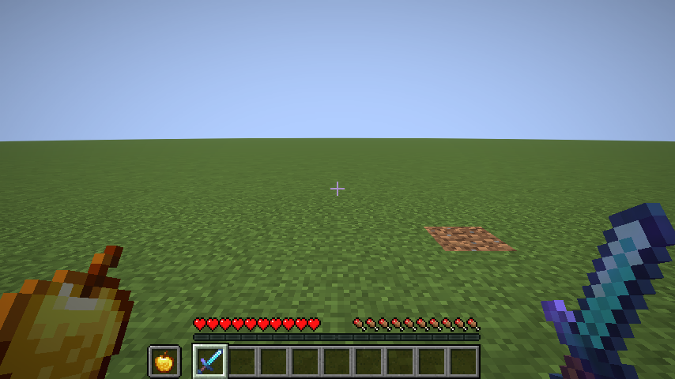
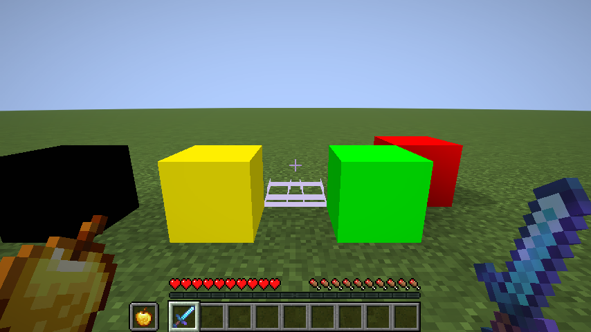

# MrClap

made by ways, discord: waystobe

a cpvp pack on top of the crystal universals cpvp base. the files in this pack win over the base.

- respawn anchor: fully red when empty, fully green when charged
- glowstone is flat bright yellow, obsidian is pure black
- placed end crystals are invisible (the item still shows)
- inventory and chest backgrounds are transparent with faint slot outlines
- purple animated glint on tools, weapons and armor (worn armor too, done with a shader)
- fire textures from the Kesu Fire pack
- everything you hold in your hand is 35% smaller in first person, main hand and offhand

from crystal universals (low fire is replaced by the kesu fire here):
- low fire: fire blocks are only a few pixels high
- no fire on screen: the burning overlay is transparent
- smaller totem particles and smaller potion particles
- every particle except totem, potion, firework and crit is turned off (block break dust and item crumbs are drawn from block and item textures, a pack can not turn them off)
- smaller totem pop on screen (the item that flashes in the middle is 30% size, item frames with a totem are smaller too)
- half full bright: the light level never goes under 65%
- enchantment levels show as 1, 2, 3 instead of I, II, III (potion levels too)
the enchant glint textures are not part of this pack. they belong to Lioren ('Old Enchant Glint Plus'). to get that glint, put that pack above this one.

fire credit: Kesu Fire pack (FIRE for CPvP).

version: minecraft 1.21.11 (pack format 75)

